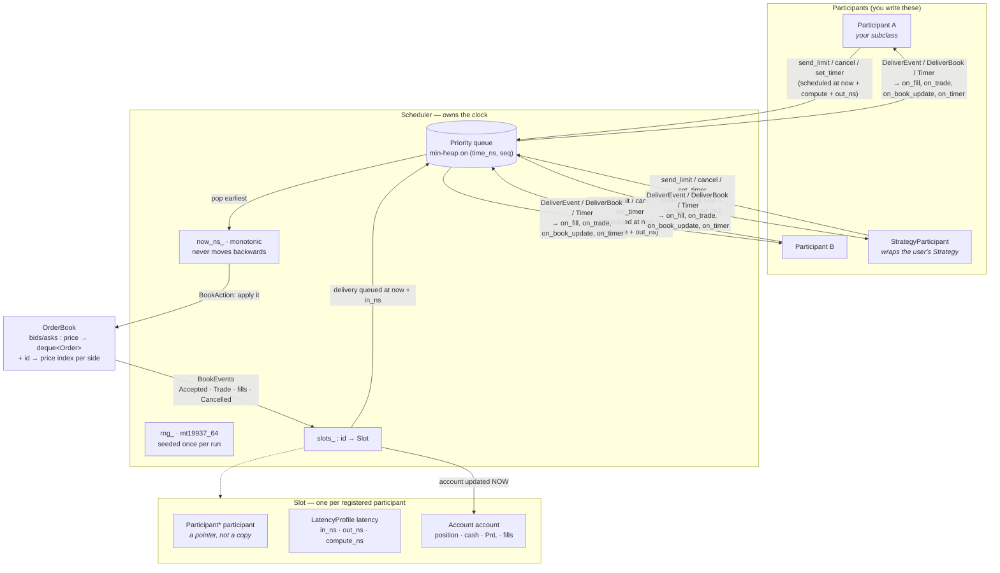
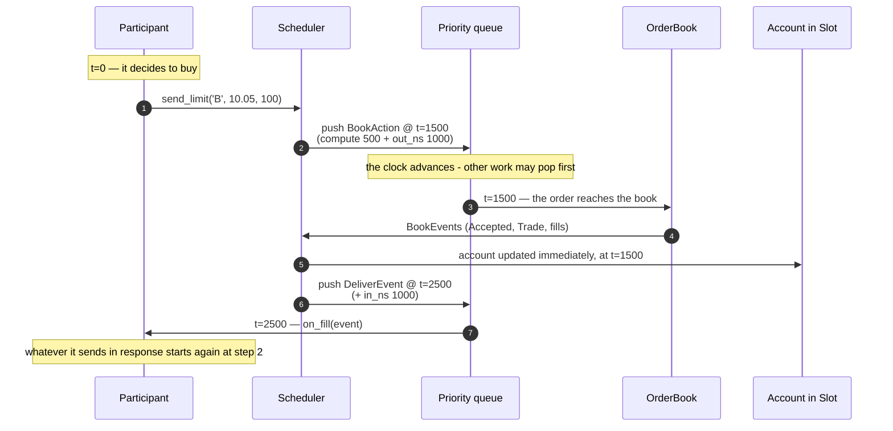
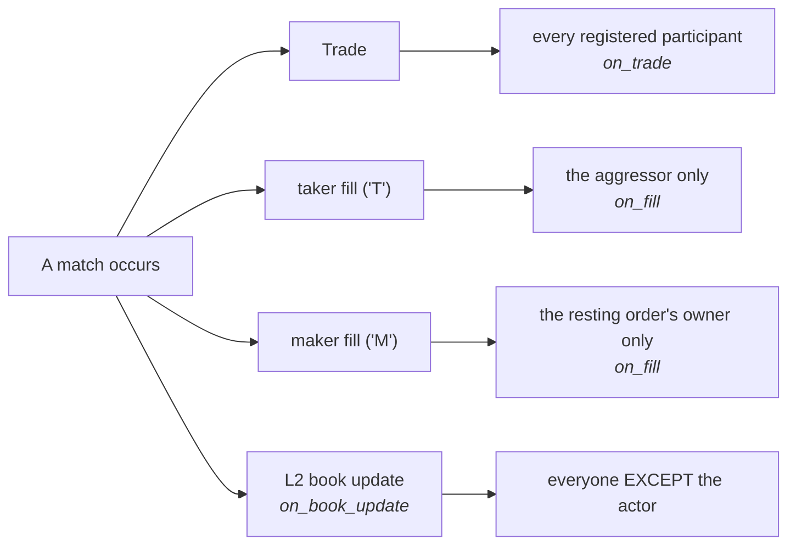
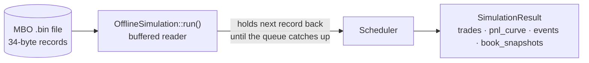

# Engine Architecture

How the simulation engine is put together: who holds what, what moves between
them, and why the timing works the way it does.

The engine lives in `sw/engine/`. Everything below is C++; the same objects are
exposed to Python through pybind11 (`bindings/src/bindings.cpp`) under the
module name `engine_sim`.

---

## The one-paragraph version

Participants don't run on their own. A **Scheduler** owns a priority queue of
timestamped work, pops the earliest item, and calls whoever that item belongs
to. A participant reacting to an event puts a new item on the queue stamped
*later* — by exactly its own latency. The **OrderBook** matches orders and
returns a list of **events**, which the scheduler routes back to participants,
again delayed by each one's latency. Nothing happens instantaneously and
nothing happens in parallel.

---

## Components



### What each box holds

| Component | Owns | Key properties |
|---|---|---|
| **Scheduler** | the queue, the clock, the book, every Slot, the RNG | `now_ns_` only moves forward; `next_order_id_` starts at `1 << 40` so engine-assigned ids can never collide with a data file's; `book_depth_` (default 5) sets how many L2 levels get broadcast |
| **Slot** | one participant's registration | `Participant*` (a pointer — the scheduler does **not** copy or own your participant), `LatencyProfile`, `Account`. Looked up by `ParticipantId` (a `uint32_t` alias) |
| **LatencyProfile** | where a participant sits | `per_exchange : id → LatencyLeg{in_ns, out_ns}`, a `fallback` leg, and `compute_ns`. Presets: Retail / Direct / Colo / Microwave |
| **Account** | the exchange's record of a participant | position, average entry, cash, realized + unrealized PnL, open orders, fill history, reject count. Updated by `on_event()` the instant a fill happens |
| **OrderBook** | the live book | `std::map<price, deque<Order>>` per side (sorted, so `begin()` is the best price; the deque preserves time priority), plus an `unordered_map<order_id, price>` index per side for O(1) lookup by id |
| **Participant** | your strategy's state | abstract base. Holds a `Scheduler*` back-pointer and its own `ParticipantId`, both set by `add_participant()` through a `friend` declaration |

> **Why the back-pointer:** `send_limit()` has to reach the scheduler to queue
> an order. The participant stores the scheduler's *address*, and the scheduler
> stores the participant's — two pointers crossing, nothing nested, no copies.

---

## The queue

A `std::priority_queue<Entry, std::vector<Entry>, Later>` — a binary heap in a
vector. `std::priority_queue` is a *max*-heap, so the `Later` comparator
deliberately reports a later time as "smaller", which turns it into a min-heap:

```cpp
struct Later {
    bool operator()(const Entry& a, const Entry& b) const {
        if (a.time_ns != b.time_ns) return a.time_ns > b.time_ns;
        return a.seq > b.seq;        // tie-break: push order
    }
};
```

That `seq` tie-break is what makes a run **reproducible**. Two things stamped
for the same nanosecond always come out in the order they were pushed, so the
same seed gives byte-identical results on every machine.

### Four kinds of Entry

| Kind | Created by | What popping it does |
|---|---|---|
| `BookAction` | a participant's `send_*` / `cancel` / `reduce` / `replace`, or the market feed | applies the action to the `OrderBook` and publishes the resulting events |
| `DeliverEvent` | `publish()`, one per recipient per event | calls `on_trade` / `on_fill` / `on_order_update` on that participant |
| `DeliverBook` | `publish()`, after every book action | calls `on_book_update` with a shared L2 snapshot |
| `Timer` | a participant's `set_timer(delay)` | calls `on_timer` |

They're separate kinds because they happen at **different times** and go to
**different people**. The book action lands at one instant; each participant
hears about it at its own instant. Collapsing them into one entry would make
latency impossible to express.

---

## Timing: one order, end to end

Follow a single order from the moment a participant decides to send it. It has
`compute_ns = 500`, `out_ns = 1000`, `in_ns = 1000`.



Three legs, and every one of them is the scheduler putting something on the
queue for later:

| Leg | From → to | Cost |
|---|---|---|
| decision → the book sees it | `send_limit` → `BookAction` popped | `compute_ns + out_ns` = 1500 ns |
| the book → the account | `publish()` | **zero** — immediate |
| the book → it knows | `DeliverEvent` popped | `in_ns` = 1000 ns |

### When the order is a reaction

The common case is a participant sending an order *because* it saw something.
That just adds one more inbound leg on the front: a trade at `t = 0` reaches it
at `t = 1000` (`in_ns`), it decides there, and the diagram above runs from that
point — so its order hits the book at `t = 2500`, not `t = 1500`, and it learns
its own fill at `t = 3500`.

Two things to take from this:

1. **Round trip is `in_ns + compute_ns + out_ns`.** A colocated participant
   with 5 µs legs and a retail one with 25 ms legs run identical code and get
   completely different fills. That is the whole point of the latency model, and it is why
   `send_limit` returns immediately instead of blocking — "immediately" in the
   participant's own timeline is still 1500 ns before anyone else can see it.
2. **The account is updated at t = 1500, but `on_fill` arrives at t = 2500.**
   `account()` is the *exchange's* live view, not a latency-delayed one, so a
   participant reading it between those two moments sees a position its own
   callbacks
   have not told it about yet. A known simplification.

---

## Event routing

One match produces three events, and they do not all go to the same place:



| Event | Recipients |
|---|---|
| `Trade` | everyone — this is the public tape |
| `PartialFill` / `Filled` | the order's owner only (looked up in `order_owner_`) |
| `Accepted` / `Rejected` | the participant who sent it |
| `Reduced` / `Cancelled` | the order's owner |
| L2 book snapshot | everyone except the participant whose action caused it |

If the resting side belonged to the recorded market feed rather than a
registered participant,
there is no maker fill to deliver — only the Trade and the taker fill go out.

---

## Where a run comes from

`OfflineSimulation` is a thin driver around the scheduler. It does **not**
touch the order book itself:



The loop alternates:

- if the queue has something due **at or before** the next file record, step the
  scheduler;
- otherwise schedule that record as a `BookAction` from participant 0
  (`MARKET_FEED`) and read the next one.

The player's strategy is participant 1 (`PLAYER`), wrapped in a
`StrategyParticipant` adapter that builds an `L1State` from the L2 update,
calls `Strategy::sync_account(...)`, then `on_market_update(...)`.

`OnlineSimulation` is **not** on the scheduler. It is paced by the wall clock
and the board replies when it replies, so simulated-time jumps don't apply. It
drives the `OrderBook` directly and keeps its own `Account` so the PnL math is
shared.

---

## Determinism

A run is a pure function of its seed. Three things guarantee it:

1. **Single-threaded.** The scheduler calls one participant at a time, as a
   normal function call. Nothing pushes to the queue while it's being popped,
   so there are no locks and no OS-scheduling nondeterminism.
2. **Total ordering.** `(time_ns, seq)` has no ties.
3. **One RNG.** `Scheduler::rng()` is the run's only randomness source.

> **Caveat:** `std::mt19937_64` produces identical output everywhere for a given
> seed, but `std::uniform_real_distribution` and friends do **not** — each
> standard library implements them differently. Derive values from `rng()()`
> directly if you need cross-platform reproducibility.

---

## Known simplifications

These are deliberate, not bugs — but they shape what conclusions a run supports.

- **One symbol, one exchange.** `per_exchange` latency exists but is never
  exercised; adding symbols means a book per symbol and per-symbol positions in
  `Account`.
- **No duplicate-order-id rejection and no ownership check on cancels.** A
  participant can cancel an id it doesn't own.
- **Accounts and `queue_position()` are live views**, not latency-delayed.
- **Shorting is unrestricted** — no borrow, no margin, no buying-power check.
  Position limits exist only where a strategy imposes them on itself.
- **The actor gets no book update for its own action**; it has to infer the new
  book from its own fills.
- **Snapshots hold the book only** — not accounts, not order ownership — so
  `restore()` is a book-level seek, not a full run rewind.
- **Simulated latency is free; the engine's own overhead is not.** Fanning a
  trade out costs roughly 1.5 µs fixed plus ~170 ns per participant in real
  time, so at 64 participants the engine needs ~10 µs to notify everyone
  regardless of what their `LatencyProfile` claims. Harmless for a simulation,
  since simulated time is independent of wall-clock time, but it caps a
  real-time-paced run. `make bench` measures it — see
  [engine-testing.md](../testing/engine-testing.md#measuring-the-engines-own-speed).
