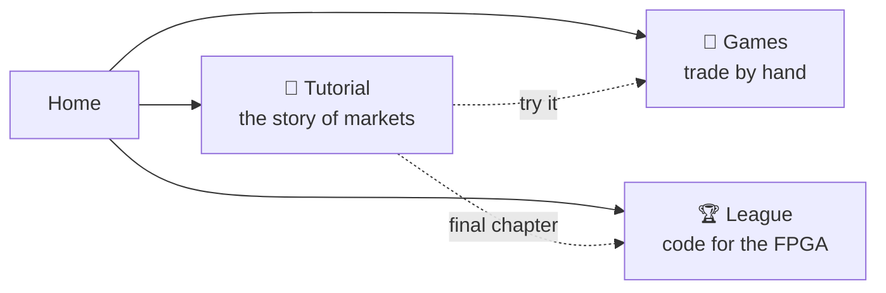

# CommonTrader app design: Tutorial, Games, League

What the whole app looks like to someone using it: the sections, what's on each, how a
student moves through them, where the FPGA fits, and what each part is built from. This is
the high-level picture. Detail for the trading games and the room runtime lives in
[game_progression.md](game_progression.md).

**Audience:** the capstone team and anyone reviewing the product direction.
**Date:** 2026-11-27.
**Status:** idea. Decisions made: three sections, **Tutorial** (a story that explains
markets), **Games** (trading by hand) and **League** (the FPGA challenge, where all the
coding happens); no separate coding section; users never need their own board. Everything
else is open to argument.

---

## The pitch

CommonTrader is an intro-to-quant app that ends on real hardware. A **tutorial** tells the
story of how markets work, from a first trade to a trading floor to a chip. **Games** let
students feel those ideas by trading by hand, alone or with others. The **League** is where
they write a strategy in C or Verilog, test it in software, and submit it to run on a real
FPGA against the bots, the kind of hardware HFT firms use.

Nothing we found combines these. Interview-practice sites (QuantVault, TraderMath) cover
market-making drills; Jane Street's Figgie is a single teaching game; IMC Prosperity and
Optiver Ready Trader Go are algorithm competitions that run once a year and close; FPGA
trading appears only in university course projects. The progression from first trade to a
strategy running on a chip is the difference.

## Who it's for

| Student | Comes for | Mostly uses |
|---|---|---|
| New to markets | What is a market, a price, a spread? Who works in quant? | Tutorial, Games |
| Preparing for quant interviews | Market-making and probability games, pricing under pressure | Games, daily challenge |
| Engineering student into low latency | Strategies, HLS, Verilog, chip development, the FPGA | League |

---

## Navigation



Top bar: **Tutorial · Games · League**, plus Home (the logo) and Profile. Coding lives
entirely inside the League: there's no separate place to write strategies that don't go to
the board.

---

## UI notes

General direction for the whole app, before the section-by-section detail.

- **One story, three doors.** The Tutorial is the way in; Games and the League are where
  the story's ideas get used. The tutorial's chapters link out to them, and the League's
  season briefs link back to the chapter that explains their topic.
- **Feel:** closer to a game than a dashboard. Illustrated, with a consistent cast of
  characters in the Tutorial; clean and data-dense where trading happens (order books,
  PnL), because that's what real trading screens look like and students should get used
  to reading them.
- **Progress is visible everywhere.** A chapter map in the Tutorial, streaks and ranks in
  Games, season standing in the League, all summarised on Home and Profile.
- **The FPGA is always on screen somewhere.** The live market banner on Home, the house bot
  in Games, the board queue in the League. It's the capstone's centrepiece.
- **Every number is explained on hover.** Spread, PnL, Sharpe, latency in ns: a tooltip
  points back to the tutorial chapter where it was introduced.
- **Desktop first.** Games and the Tutorial should work on a phone; the League's editor
  needs a laptop.
- **Light and dark themes,** since trading screens are usually dark and reading pages
  usually light.

---

## Home

Where to go next, not a menu. It always shows the live market, so the FPGA is the first
thing a visitor sees.

```
┌──────────────────────────────────────────────────────────────┐
│ CommonTrader                 Tutorial  Games  League   (you) │
├──────────────────────────────────────────────────────────────┤
│ ● LIVE  House bot on the FPGA · PnL +3,412 · 96 ns median    │
│         12 people trading against it          [Join ▶]       │
│                                                              │
│ Continue the story: Chapter 3, "Making a market"  ▶          │
│ Today: Make a market (3 dice)   You: —   Best: +412  [Play]  │
│ League: Season 2 "Fee war" · closes Fri · you: #14           │
└──────────────────────────────────────────────────────────────┘
```

---

## Tutorial: the story of markets

The tutorial explains markets as a **story**, not a list of lessons. The student follows a
newcomer through a trading career, guided by a mentor, and each chapter introduces a few
ideas at the moment the story needs them. Our own characters and setting; no real firms.

### The chapters

| # | Chapter | Story beat | Ideas introduced | Unlocks |
|---|---|---|---|---|
| 1 | **The market square** | Selling at a town market; prices change with how many people want something | What a price is, supply and demand, auctions | Auction games |
| 2 | **The exchange** | The town's traders move onto an exchange | Order book, bid and ask, spread, limit vs market orders, queue priority | Double auction |
| 3 | **Making a market** | The newcomer is asked to quote both sides for the first time | Market making, earning the spread, inventory risk | Make a market |
| 4 | **Someone knows more than you** | A trader keeps buying from them right before the price rises | Adverse selection, information in trades, the winner's curse | Make a market vs the Shark; common-value auction; card market |
| 5 | **The risk desk** | The risk manager reviews the newcomer's week | PnL (realised vs unrealised), returns, variance, volatility, Sharpe, drawdown, skew and fat tails, bet sizing | Betting games |
| 6 | **Who's who** | A tour of the industry | Buy side vs sell side; market makers, prop shops, HFT, hedge funds; quant researcher, quant trader, quant dev | — |
| 7 | **Patterns in the noise** | The newcomer looks for strategies that work | Mean reversion, trend / momentum, regimes, statistical arbitrage, overfitting | League practice scenarios |
| 8 | **The race** | They keep losing trades to someone faster | Latency, colocation, why speed matters, the HFT arms race | Live market vs the FPGA |
| 9 | **Into the chip** | They visit the hardware team | What an FPGA is, why firms use them, HLS (C to circuit), Verilog, pipelining, cycles, resources | **The League** |

Chapter 9 ends by handing the student their first League design: the house bot's strategy,
to read and modify.

### How a chapter looks

```
┌──────────────────────────────────────────────────────────────┐
│ Chapter 3 · Making a market                    ● ● ● ○ ○  3/5│
├───────────────────────┬──────────────────────────────────────┤
│                       │ MENTOR: "Someone wants to buy, and   │
│   [illustration:      │ someone wants to sell, but never at  │
│    trading desk,      │ the same moment. You stand in the    │
│    mentor pointing    │ middle and quote both."              │
│    at a screen]       │                                      │
│                       │  ┌ Try it ───────────────────────┐   │
│                       │  │ A buyer and a seller arrive.  │   │
│                       │  │ Bid [ 99.5 ]  Ask [ 100.5 ]   │   │
│                       │  │ You earned the spread: +1.00  │   │
│                       │  └───────────────────────────────┘   │
│                       │                    [◀ Back] [Next ▶] │
└───────────────────────┴──────────────────────────────────────┘
```

- **Panels, not pages:** a chapter is 5–10 short screens with an illustration, the
  dialogue, and often a small interactive "try it" box.
- **Try-it boxes are tiny:** one decision, instant feedback. They are not full games; each
  chapter ends with a button to the related game for the real thing.
- **A short check at the end:** two or three questions. Wrong answers point back to the
  panel that explains it.
- **Chapter map** with progress, so a student can see the whole story and return to any
  chapter. All chapters are open from the start; the map only suggests an order.
- **Glossary** built from the chapters: every term links to the panel that introduced it.

**Writing it:** draft the script and dialogue with AI, then check every chapter by hand,
especially formulas and claims about the industry. Store chapters as Markdown / MDX (one
file per chapter, panels as sections) so they're reviewed like code. Illustrations need a
consistent style; decide early whether they're drawn, generated, or simple diagrams.

---

## Games: trade by hand

People trade by clicking. No code.

### The games

| Family | Games | Teaches |
|---|---|---|
| Auctions | English, Dutch, sealed first-price, sealed second-price, common-value, double auction | Price discovery, bid shading, the winner's curse |
| Fair price and market making | Make a market on an unknown number, card market, confidence intervals | Spreads, adverse selection, updating on information, calibration |
| Probability and betting | Price the game, stop or continue, edge betting | Expected value, optimal stopping, bet sizing |

Each game has a short intro screen with the rules and a link to the tutorial chapter behind
it, then **Play solo** (pick a bot level: Random, Naive, Bayesian, Shark) or **Join / create
a room**. Rooms fill empty seats with bots. Most games are turn-based and run on a Python
game framework; the card market runs on the C++ order book. Full catalogue, bots, rules, and
room walkthroughs: [game_progression.md](game_progression.md), Parts 1 and 2.

Content comes from **game templates filled in from a seed** (dice, cards, payoff rules), so
there's no question bank to maintain except for confidence-interval questions. Those are
drafted with AI, checked against a source, and stored with it. Fair prices for probability
games are always computed by code, never by a model.

```
┌──────────────────────────────────────────────────────────────┐
│ Games                                                        │
├──────────────────────────────────────────────────────────────┤
│ ● LIVE MARKET vs the FPGA house bot · 12 trading   [Join ▶]  │
│ ★ Daily: Make a market (3 dice) · 1,204 played     [Play ▶]  │
├──────────────────────────────────────────────────────────────┤
│ Auctions          Market making       Probability & betting  │
│ [English]         [Make a market]     [Price the game]       │
│ [Sealed-bid]      [Card market]       [Stop or continue]     │
│ [Common-value]    [Conf. intervals]   [Edge betting]         │
├──────────────────────────────────────────────────────────────┤
│ Open rooms: Card market (3/6) · Sealed-bid (2/4)  [Browse]   │
└──────────────────────────────────────────────────────────────┘
```

### Daily challenge

- One game a day, rotating through the families.
- Everyone gets the same seed: same deal, same bot moves.
- One ranked attempt, unlimited unranked practice on other seeds.
- Seed hidden until the day starts; full answers after the deadline.
- Afterwards: percentile, a replay against the fair price, and an AI-written explanation
  built from the game's real data ("the Shark bought because your ask was below fair value
  given the 6 showing").

### Live market (the FPGA house bot)

Pinned to the top of Games. A market that's always open, where the team's own strategy runs
on the FPGA against the simulated bots, and anyone can join and trade by hand against it.

- **What runs on the board:** the existing EMA mean-reversion strategy in
  [alpha_engine_core.sv](../../../rtl/alpha_engine/alpha_engine_core.sv). Its rules are
  published, and its threshold sets a difficulty level.
- **How users join:** like any room. The user's browser connects over a WebSocket; the
  board connects over ITCH/OUCH; both send orders into the same scheduler on the server.
- **What users see:** the book, their fills, and a panel for the house bot: its trades,
  PnL and on-chip latency.
- **Why it's here:** students see a real chip trading, and feel how fast it is compared
  with clicking. One board serves any number of people, because it's one market.

The board is shared with the League; see [The board](#the-board-two-roles-one-queue).

---

## League: code for the FPGA

The League is the app's only coding section. A student writes a strategy in **C (through
HLS) or Verilog**, tests it in software to see how well it does, then submits it. It is built
into the full chip design and run on the real board against the bots.

### League pages

```
┌──────────────────────────────────────────────────────────────┐
│ League · Season 2 "Fee war" · closes Fri 18:00   [Brief ▸]   │
├──────────────────────────────────────────────────────────────┤
│ Your best: fast_reversion v4 · #14 of 212 · +1,930 pts       │
│ Board queue: 3 ahead of you · ~45 min           [Workshop ▶] │
├──────────────────────────────────────────────────────────────┤
│ LEADERBOARD          profit   latency   total                │
│ 1  quantpanda        +1,410   +960      2,370                │
│ 2  ...                                                       │
└──────────────────────────────────────────────────────────────┘
```

- **Season home:** the brief (theme, scenarios, rules, hardware budget, links to the
  tutorial chapters behind them), your standing, and the leaderboard.
- **Workshop:** the editor, where designs are written and tested (below).
- **My designs:** every design and every saved version, with its test results and
  submissions. Every result points at an exact version, so it can always be reproduced and
  nobody can change code after submitting.
- **Submissions:** status of each submission through build, queue, run and score.
- **Past seasons:** final leaderboards and the winning designs' stats.

### C and Verilog are interchangeable

Both fill the same fixed slot on the chip: the ports of
[alpha_engine_core.sv](../../../rtl/alpha_engine/alpha_engine_core.sv), with top of book in
and an order out. HLS turns C into Verilog, so both end up as the same thing, and everything
after that point is identical. C just has one extra step at the front:

```
C ──(Vitis HLS)──▶ Verilog ──▶ Verilator test ──▶ build + gate ──▶ board
                   Verilog ──▶ (same)
```

- **C via HLS:** easier; gets a fast native software test and the HLS report (cycles,
  resources).
- **Verilog:** full control; skips HLS. More designs fail timing or synthesis, which the
  gate catches before they reach the board.
- **Both at launch.** The Verilog path is a subset of the C path, so it costs little extra.
  Leaderboards don't separate them: a design scores the same whichever language it came
  from.
- Hardware rules out things software allows (dynamic memory, unbounded loops, floating
  point), so strategies have to be designed for it. That's part of what the League teaches.

### The Workshop: test without the board

| Step | C | Verilog | Board? | Tells the student |
|---|---|---|---|---|
| **Check** | Compile + HLS rule pre-check (seconds) | Lint + port check against the slot (seconds) | No | The design is legal for the slot |
| **Software test** | Native C in the offline scheduler (seconds) | — | No | Does it make money, quickly |
| **Synthesise** | Vitis HLS (~1–3 min) | Vivado out-of-context synthesis (minutes) | No | Cycles → latency in ns; LUT / FF / BRAM against the season's budget |
| **Cycle-accurate test** | Verilator on the generated RTL (minutes) | Verilator on the student's RTL (minutes) | No | Exact behaviour and latency; a provisional score on practice seeds |
| **Submit** | ~15 min build + queue + 15 min run | same | **Yes** | The real score from the board |

**What it tests against.** Two kinds of scenario, both run in the offline scheduler with the
same bots and scoring as the board:

- **The season's practice seeds:** the season's scenarios with published seeds. The scoring
  seeds are held back.
- **Training scenarios**, always available, one per market regime, so students can learn
  how a strategy behaves in each:

  | Scenario | How the fair-value process makes it | Strategy it rewards |
  |---|---|---|
  | Noise only | Random flow around a steady price | Market making, spread capture |
  | Mean-reverting | Price pulled back toward a level | Mean reversion |
  | Trending | Steady drift | Momentum / trend |
  | High volatility | Large random moves | Wider quotes, smaller size |
  | Skewed / crash-prone | Rare large jumps, mostly downward | Risk control |
  | Thin liquidity | Fewer bots, smaller orders | Careful execution |
  | Regime switch | Behaviour changes partway through | Adapting, not overfitting |

**How the software test works.** The design runs as a participant in the offline scheduler.
For C, the code is compiled natively and its synthesised cycle count sets how fast it
reacts. For Verilog (and for C once synthesised), Verilator turns the RTL into C++ that
plugs into the scheduler cycle by cycle. So the software score predicts the board score, and
the board run confirms it on real hardware. Results show PnL, fills, risk stats (volatility,
Sharpe, drawdown), latency, the replay viewer and "why did I lose this race".

```
┌──────────────────────────────┬───────────────────────────────┐
│ fast_reversion [C ▾|Verilog] │ Test on: Season 2 practice ▾  │
│ v4 (saved)                   │ [Check] [Test] [Synthesise]   │
│                              │ [Cycle-accurate test]         │
│ void alpha(const TopOfBook&  │ PnL ╱╲╱‾‾╲__╱‾   +830         │
│   tob, const Position& pos,  │ 22 cycles = 88 ns · II 1      │
│   OrderOut& out) {           │ LUT 1.9k / 3k budget  ✓       │
│ #pragma HLS PIPELINE II=1    │ Sharpe 1.6 · DD −3%           │
│   ...                        │ ▸ Replay  ▸ Why did I lose?   │
│                              │ [Submit to board ▶]           │
└──────────────────────────────┴───────────────────────────────┘
```

### After Submit

```
Submit v4 ──▶ Build (~15 min, build machine) ──▶ Gate ──▶ Queue ──▶ Run on board vs bots ──▶ Score
              Vivado bitstream with the         synthesis,          15 min of market data,
              student's alpha engine            timing, budget,     2–4 scenarios at once,
                                                DRC must pass       1x wall clock, hidden seeds
```

- **The gate** means a design that fails synthesis, timing, the resource budget or DRC is
  sent back with the report and never uses board time.
- **The user sees a status bar** ("Building → Queued (3rd) → Running → Scored") and gets a
  notification when it's done. Seasons have a weekly or end-of-season deadline, so nobody
  waits on a result interactively.

### One board, one user at a time: is that enough?

Yes, because the board is the **judge**, not the workspace. Writing and testing (the whole
Workshop) runs on servers and handles any number of users. The board only runs final
submissions. Builds also don't occupy it: they run on a build machine, several in parallel
if there are cores to spare.

**A run is 15 minutes of market data**, with the season's 2–4 scenarios running at the same
time on separate order books. So a run takes 15 minutes however many scenarios it has, and
only the number of runs per submission sets capacity:

| Board runs per submission | Per hour | Per day | Per week |
|---|---|---|---|
| 1 | 4 | ~96 | ~670 |
| 3 (median counts) | 1.3 | ~32 | ~220 |

So **each ranked submission gets one board run.** Repeat runs are only for the top of the
leaderboard or close calls. At one ranked submission per student per week, one board covers
about 600 students. It isn't internet scale and doesn't need to be. It works like any shared
instrument (booking time on a telescope, or a single test track): develop and test anywhere,
then book the real thing for the final measurement.

**Growing it, if needed:**

1. **Several students per run.** Today the top level has one alpha engine
   ([commontrader_top.sv](../../../rtl/top/commontrader_top.sv)), but the chip is only
   at about 5% LUT / FF use ([timing_closure.md](../../../docs/reports/timing_closure.md)).
   A batch bitstream could hold up to five students' engines, one per Stock Locate book,
   each student on their own book and scenario so they don't affect each other. That's up
   to 5x the capacity, at the cost of one scenario per student per run instead of 2–4. With
   15-minute runs this is the first thing to build if the queue gets long.
2. **More boards.** The queue picks whichever is free; the bitstreams are the same.
3. **Faster builds:** cache by source hash (the same code never rebuilds); Vivado
   incremental builds (only the alpha engine changes); partial reconfiguration (DFX,
   supported on Artix-7) to rebuild and load only the engine's region. DFX is the proper fix
   but advanced work, so last.

### Scoring

**2–4 scenarios at once.** The board keeps five independent order books, selected by the
ITCH Stock Locate field, and names the asset in every OUCH order. Scenario *k* goes to
locate *k*; one pacing loop drives one scheduler per scenario on one wall clock. The season
sets how many scenarios a run has. Detail: [game_progression.md](game_progression.md),
Part 3.

Per scenario: profit points (PnL against a reference strategy's PnL on the same scenario,
clipped, minus an inventory or drawdown penalty) plus latency points (median and p99 of the
board's own parser-to-TX telemetry, in 4 ns ticks, over filled orders only). Latency points
count only if profit points are ≥ 0. The total is the weighted sum over the season's 2–4
scenarios. One board run per submission; the top of the leaderboard and close calls are
re-run, and the median of those runs counts.

### Seasons

Each season is a set of scenario configs plus scoring weights, so new ones are cheap. Vary:

| What | Examples |
|---|---|
| Market regime | Trending, mean-reverting, crash-prone, regime switch |
| Bot population | More momentum bots, a fast arb bot, a large institutional seller |
| Exchange rules | Maker-taker vs taker-maker fees, tick size, a speed bump |
| Constraints | Position limit, max drawdown, order-rate limit |
| Objective | Profit, risk-adjusted, execution (buy 50k shares near the day's average price), keep quotes up 90% of the time |
| Hardware budget | Must fit in N LUTs / BRAMs; required II = 1 (C); latency weight in the score |

Give each a theme and a brief ("Fee war", "Flash crash", "The whale") that links to the
tutorial chapters it relies on. **Score on hidden seeds:** practice seeds are published, the
scoring set is held back, so students can't tune to what they've seen. A **hidden extra
scenario** on a spare locate (one of the five books the season doesn't use) can serve the
same purpose.

### Risks

- **Board downtime stalls the League.** Fall back to cycle-accurate (Verilator) scores,
  marked provisional, and rerun on the board when it's back.
- **Real-time runs vary a little.** Re-run the top of the leaderboard and close calls and
  take the median; the latency telemetry is measured on-chip and barely moves.
- **User designs in hardware.** The fixed slot and the gate limit what a design can do; also
  reject designs that drive anything outside the slot's ports. Vitis C-sim, Verilator and
  native compiles all run user code, so every job needs a sandbox.

---

## The board: two roles, one queue

| Role | When | Runs |
|---|---|---|
| **League judge** | Whenever submissions are queued | The student's bitstream, 15 min with 2–4 scenarios, then reports scores |
| **House bot** | Whenever the queue is empty | The team's EMA strategy in the live market |

One scheduler service owns the board. When a League run is due, the live market pauses with
a banner ("the board is judging a submission, back in ~15 min") and the house bot is
reloaded afterwards. Students never connect to the board directly and never need one.

The board also gives the report its validation story: the house bot's strategy is ported to
the software engine too, so the same strategy runs in both and the simulator's hardware
latency numbers come from real measurements. (Today the software template and the hardware
strategy are different algorithms; see
[hw_sw_interface.md §6](../../../docs/hw_sw_interface.md).)

---

## How one idea runs through the app

| Idea | Tutorial chapter | Games | League |
|---|---|---|---|
| Price discovery | 1, 2 | Auctions, double auction | — |
| Spread and market making | 3 | Make a market | Season objective: quote uptime |
| Adverse selection | 4 | Make a market vs the Shark; card market | Crash-prone scenarios |
| Winner's curse | 4 | Common-value auction | — |
| Volatility, Sharpe, drawdown | 5 | Edge betting | Every test result; risk-adjusted objective |
| Mean reversion / momentum | 7 | — | Training scenarios; regime seasons |
| Latency | 8 | Live market vs the FPGA | Synthesise; latency points |
| Chip development | 9 | — | The Workshop, hardware budget |

---

## Site map

```
Home
├── Tutorial
│   ├── Chapter map (1–9, progress)
│   ├── Chapter → panels → check
│   └── Glossary
├── Games
│   ├── Live market (FPGA house bot)
│   ├── Daily challenge + leaderboard
│   ├── [game] intro → Play solo (bot level) · Join or create room
│   └── Rooms lobby
├── League
│   ├── Season home (brief, standing, leaderboard)
│   ├── Workshop (C or Verilog: Check · Test · Synthesise · Cycle-accurate test · Submit)
│   ├── My designs (versions, test results)
│   ├── Submissions (build → queue → run → score)
│   └── Past seasons
└── Profile
    ├── Tutorial progress
    ├── Game history and daily scores
    └── League designs, submissions, season results
```

Today's pages map in directly: `AlphaEngineCompilerPage` becomes the League Workshop,
`StrategyCompilerPage`'s run-and-results view becomes the Workshop's software test, and
`OnlineDemoPage` becomes the live market view.

---

## Accounts, storage and safety

- **Accounts:** login plus roles (student, instructor, admin). Self-hosted in FastAPI
  (`fastapi-users`, or argon2 + httpOnly session cookies) works on a lab network with no
  internet; a hosted service (Supabase, Auth0, Clerk) is less work if internet access is
  fine. Either way, no home-made password or token code.
- **Storage:** Postgres (the current SQLite run log won't hold up with live rooms). Designs
  and every version as text in the database; build outputs (HLS reports, Verilator models,
  bitstreams) on disk keyed by source hash; every test and run records version + scenario +
  seed.

  ```
  users            (id, email, role, created_at)
  tutorial_progress(user_id, chapter, panel, check_score)
  designs          (id, user_id, name, language: c | verilog)
  design_versions  (id, design_id, source, source_hash, created_at)
  builds           (id, version_id, kind: native | hls | verilator | bitstream, status, artifact_path, report)
  tests            (id, user_id, version_id, scenario_id, seed, results…)
  submissions      (id, season_id, version_id, status, score, board_runs…)
  ```
- **Sandbox, before public sign-ups:** today `strategy_compile_manager.py` compiles and
  runs user C++ as the server's own user with only timeouts. Every compile, test, HLS,
  Verilator and C-sim job needs its own container or nsjail: no network, its own workspace
  only, CPU / memory / process limits, a separate Unix user.

---

## What it's built from

| Piece | Used by | Status |
|---|---|---|
| Accounts, roles, Postgres, versioned designs | everything | new |
| Tutorial chapters (MDX), illustrations, try-it widgets, glossary | Tutorial | new |
| Python game framework, bots, daily challenge | Games | new |
| Rooms server (WebSocket, lobby) | Games, live market | new |
| Wall-clock runtime + market-data tap + risk check | Card market, live market, League runs | new |
| Offline scheduler, accounts, latency model | League software test | **exists** |
| Agents and fair-value regimes | League scenarios | ticketed (#11–18) |
| Light calibration (LOBSTER + free minute bars) | League scenario realism | new, 2–4 days ([calibration_11242026.md](calibration_11242026.md)) |
| Sandbox for user code | League | **new, needed before public sign-ups** |
| HLS pipeline (Check, Synthesise) | League (C) | ticketed |
| Hardware design as a scheduler participant (native C, Verilator RTL) | League software test | new |
| Build service + gate (synthesis, timing, budget, DRC) | League | new |
| Board queue (shared by League runs and the live market) | League, live market | new |
| FPGA participant + transport fixes | League, live market | ticketed (#58) |
| Multi-slot batch bitstream (up to 5 engines) | League capacity, later | new, RTL |

---

## Phases

1. **Story and play:** accounts, Tutorial chapters 1–5, game framework, make a market and
   two auctions against bots, daily challenge. Teaches something with no hardware involved.
2. **Social:** rooms, card market, more games; Tutorial chapters 6–8.
3. **League without the board:** sandbox, Workshop for C and Verilog with Check, software
   test, Synthesise and the cycle-accurate test, training scenarios, seasons scored
   provisionally; Tutorial chapter 9.
4. **Board:** transport fixes, the live market with the house bot, then real League runs
   (build service, queue, 15-minute runs on the board, final scoring).

Phases 1–3 can all be built and tested on a laptop. Phase 4 depends on the board and has its
own risks, so nothing before it waits on hardware.

---

## Open questions

- **Who draws the tutorial?** Illustrations set the app's look; drawn, generated or simple
  diagrams is an early decision.
- **Should the tutorial gate anything?** Currently everything is open and the chapter map
  only suggests an order.
- **Do instructors need a class view:** private rooms, a League season for their group,
  student progress?
- **How often does a season run,** and does each student get one submission per day or
  per week?
- **Is the app public or limited to a class?** That decides how much sandbox and account
  security comes first.
- **What exactly is the slot's interface?** Verilog students need a written port spec
  (widths, price scale, handshake, timing) for `alpha_engine_core`; HLS students need the
  matching C struct. One spec should generate both.
- **Should finals be head-to-head?** The top designs could trade in the same market,
  repeatably offline first, then on the board.
