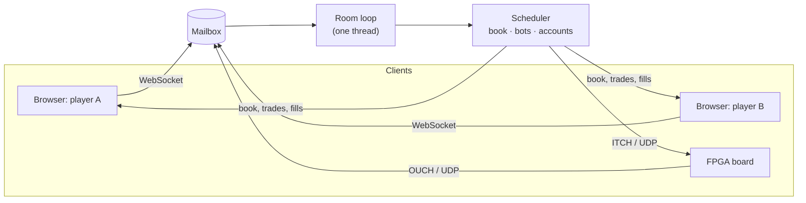

# Game progression: trading games, multiplayer rooms, and the board challenge

The app has two main sections, and this doc covers new pieces of both:

- **Trading Games**, where people trade by hand: auctions, fair-price and market-making
  games, and the probability and betting games used in quant interviews. Played solo against
  bots or against other people in rooms. (Parts 1 and 2.)
- **Quant Dev**, where students write a strategy, run it offline, synthesise it with HLS and
  finally run it on the FPGA. This doc adds **the board challenge**: one strategy against
  four scenarios at once, with one total score for profit and latency. (Part 3.)

**Audience:** software team, plus whoever owns the RTL interface for the board section.
**Date:** 2026-11-24.
**Status:** idea. Two framing decisions are made: trading games are played by hand, not by
algorithms; and in Quant Dev the offline game is the main game, with the board as its final
stage, not a separate mode. Everything else is open to argument.

> **Update 2026-11-27:** the app structure is now in [app_design.md](app_design.md):
> Tutorial, Games and League. "Trading Games" here is the Games section. "Quant Dev" no
> longer exists as its own section: all coding happens in the League, where strategies are
> written in C or Verilog, tested in software, and run on the board. The board challenge in
> Part 3 still holds and is the League. app_design.md adds how submissions reach the board
> (build, gate, queue, then a 15-minute run) and how the board is shared with the live
> market's house bot.

---

## The one-paragraph version

Trading Games is a catalogue of hand-played games: auctions, making a market on an unknown
number, a card market, confidence intervals and betting games. Most are turn-based and run
on a small game framework in the Python service. The continuous ones use the C++ order book.
Bots at four difficulty levels are the opponents in solo play and fill empty seats in rooms.
A seed fixes the whole deal, so a daily challenge lets everyone compete on the same game
without being online together. Live rooms use a wall-clock loop, and to the engine a human
in a room and the FPGA board are the same thing: **an external participant sending orders
into a scheduler paced by the wall clock**. Build that runtime once for rooms and the board
challenge reuses it. In Quant Dev, the offline scheduler stays the main game, because
scoring and replay need runs that repeat exactly. The board challenge maps four scenarios to
four of the board's five order books, runs them side by side at 1x, and scores each one on
profit and on the latency the board measures itself. The per-scenario scores add up to one
total.

---

## Where each piece sits

| Section | Stage | Who plays | Pace | Repeats exactly? | Scored? |
|---|---|---|---|---|---|
| Trading Games | Solo / daily challenge | one human vs bots | human speed | **yes** (seed + action log) | yes, daily leaderboard |
| Trading Games | Rooms | humans (+ bots) | human speed, wall clock | no, but the action log replays | per room |
| Quant Dev | Run (offline) | the student's code | as fast as the CPU | **yes** (seed) | **yes** |
| Quant Dev | Synthesise (HLS) | the student's code + HLS cycle count as latency | as fast as the CPU | **yes** | yes |
| Quant Dev | Board challenge | the same code on the FPGA | 1x wall clock | no (see [Repeatability](#repeatability)) | yes, as its own leaderboard |

The offline Quant Dev game can still look live. It computes the whole run in milliseconds, then
streams the event log to the UI at whatever playback speed the player picks. Playback
speed can't change the result.

---

## Part 1: trading games

People trade here by hand. Nobody writes code. Writing algorithms is the Quant Dev section.
These are the games quant firms use to teach and interview: auctions, pricing an unknown
quantity, making a market, and betting with an edge. Each one can be played **solo against
bots** or **against other people in a room**.

### The catalogue

**Auctions**: how a price gets found, and how to bid.

| Game | How it plays | Teaches |
|---|---|---|
| English (rising) auction | Price goes up; players drop out; last one in wins | Bidding up to your value, no further |
| Dutch (falling) auction | Price falls until someone claims it | Bidding under uncertainty about others |
| Sealed first-price | One secret bid each; highest pays their own bid | Bid shading |
| Sealed second-price | Highest wins but pays the second-highest bid | Why bidding your true value is optimal |
| Common-value auction | Item's value is the same for all; each player gets a noisy clue | **Winner's curse**: winning means you were the most optimistic |
| Double (call) auction | Everyone submits buys and sells; the round clears at one price | Supply and demand, price discovery |

**Fair price and market making**: the core of a trading interview.

| Game | How it plays | Teaches |
|---|---|---|
| Make a market | An unknown number (sum of hidden dice, a hidden card total, an estimation question). You quote a bid and ask; the opponent buys or sells at your price. More is revealed each round. Settles at the true value. | Spread width vs. what you know, adverse selection, updating on information |
| Card market | Each player holds private cards. Everyone trades a contract on the **sum of all cards** in a live order book. Cards are revealed in stages. | Pricing from partial information, reading other people's trades, inventory risk |
| Confidence intervals | Give a 90% range for quantities you can't know exactly | Calibration: being honest about uncertainty |

**Probability and betting**: expected value and sizing.

| Game | How it plays | Teaches |
|---|---|---|
| Price the game | A dice or card game with a payoff rule; you name what you'd pay to play | Expected value |
| Stop or continue | Keep rolling or drawing, and stop to bank what you have | Optimal stopping |
| Edge betting | Repeated bets on a biased coin with a bankroll | Bet sizing (Kelly), ruin, variance |

Sizes and payoffs above are starting points. Tune them once people play.

### Two kinds of game, two engines

Most of these are **turn-based**: a round opens, players act, the round resolves. That
doesn't need the C++ order book. A small **game framework in the Python service** covers
them all: each game is a state machine with phases, private information per player, the
allowed actions and a settlement rule.

Two games are **continuous**: the card market and the double auction when it runs as a
live book. They use the C++ order book through the room loop in Part 2.

Don't route everything through the C++ engine. Turn-based games are simpler and easier to
change in Python, and the engine stays focused on the order book.

**Hidden information stays on the server.** A player's client only ever receives their own
cards and clues. The true value is sent once the game settles. Otherwise anyone with the
browser's dev tools can read it.

### Bots as opponents

Each game needs bots for solo play and to fill empty seats in rooms. Give them difficulty
levels, built from the same few behaviours:

| Level | Behaviour |
|---|---|
| Random | Acts at random within the rules. Teaches the controls. |
| Naive | Uses only its own clue, plus a little noise. |
| Bayesian | Updates its estimate from what others do, such as trades and bids. |
| Shark | Trades only when your price is wrong given what it knows. Punishes wide-open or mispriced quotes. |

The Shark is what makes the market-making games teach anything: if your quote is off, you
get picked off, which is adverse selection in practice.

Bots draw all randomness from the game's seed, so a solo game can be replayed exactly.

### Seeds give fair competition without being online together

A game is fully set by its seed: which cards, which dice, which clues, how the bots act. So:

- **Daily challenge:** everyone plays the same seed that day, solo against the same bots,
  and compares scores on a leaderboard. This is PvP that doesn't need two people online.
- **Rematch:** replay a game you lost with the same deal.
- **Live rooms** are the real-time version, covered in Part 2.

### Scoring

- **Trading games:** final cash plus position, valued at the revealed true value.
- **Interview-style games:** also score how you traded, not just the result. For example,
  how tight your quotes were, how calibrated your ranges were, and how close your bets
  were to the Kelly size. Profit alone rewards luck.

### Limits

Human players need limits the engine doesn't have yet (it allows unlimited shorting with no
cash check; see *Known simplifications* in
[engine-architecture.md](../design/engine-architecture.md)):

- a position limit and a cash limit per player, checked when an order lands;
- an order-rate limit per player in continuous games;
- cancel-on-disconnect: a player who drops loses their resting orders.

In the C++ engine these belong in the scheduler's `submit()` path as a per-participant risk
check, so the board's risk gateway limits (1000 orders/s, qty and value checks) can reuse
them later. Turn-based games enforce their own limits in their rules.

### Suggested order

1. Make a market (solo vs bots). It's the most recognisable interview game and is
   turn-based.
2. Sealed-bid and common-value auctions.
3. Price the game, stop or continue, edge betting.
4. Card market (continuous, needs the room loop).
5. Rooms for all of the above.

---

## Part 2: rooms and the external-participant runtime

A room hosts one trading game for several people. Turn-based games need only the Python
game framework: the room collects each player's action for the round over the WebSocket,
resolves it, and sends each player their own view. Continuous games (the card market, a
live double auction) also need a C++ scheduler, paced by the wall clock as below. The rest
of this part is about that case, because it's the one the FPGA board shares.

### A room, start to finish

1. **Create:** pick the game, the number of seats (2–8), the bot level, and whether the
   room is public or private (joined by code).
2. **Lobby:** bots hold every empty seat; a human who joins replaces one. The host presses
   Start whenever they like, so nobody waits for a full room.
3. **Play:** the game runs in phases, each with a timer.
4. **Results:** scoreboard, the true value revealed, a replay, and the AI explanation.
5. **Rematch:** the same deal again, or a new seed.

Anyone can join as a spectator. A player who disconnects has 60 s to come back; after that
a bot plays their seat so the game carries on.

### How multiplayer works

- **The server holds the game;** browsers only show it and send actions.
- **One WebSocket per player:** actions go up, and each player gets back **their own
  view**: their cards and clues, never anyone else's.
- **Every phase has a deadline.** When it passes, the server resolves the phase. A player
  who didn't act passes, or their bot acts for them.
- **Everything comes from the seed,** and every action is logged, so any game can be
  replayed exactly.
- **Turn-based games** run as a Python state machine; **continuous games** (the card market)
  run the C++ scheduler paced by the wall clock, described below.

### Three games, walked through

**Make a market** (turn-based, 2–6 players)

```
┌──────────────────────────────────────────────────────────┐
│ Make a market · Round 2/4 · Contract = sum of 3 dice     │
│ Revealed: [5]          Market maker this round: YOU      │
├──────────────────────────────────────────────────────────┤
│ Your quote:  Bid [ 9.5 ]  Ask [ 11.5 ]  Size [10]  ⏱ 0:22│
│                                                          │
│ Seats: Alex (human) · Sam (human) · Bot-Bayesian · Bot   │
│ Last round: Alex bought 10 @ 13 · Sam passed             │
└──────────────────────────────────────────────────────────┘
```

- The market maker role rotates each round. They quote a bid, an ask and a size within
  30 s.
- Everyone else picks **buy, sell or pass at the same time**; choices are revealed
  together.
- The next die is revealed, and the role passes on.
- At the end, positions settle at the true sum. Score: profit, plus quote width and how
  often you were picked off.

**Common-value auction** (turn-based, 3–8 players)

- Five items per game. Each item is worth the same to everyone; each player gets a private
  noisy clue ("between 40 and 60").
- Everyone submits a sealed bid within 30 s. Bids are revealed, the highest pays, then the
  true value is shown.
- Results include a winner's-curse stat: how often the winner overpaid.

**Card market** (continuous, 3–8 players)

```
┌──────────────────────────────┬───────────────────────────┐
│ Card market · 3:12 left      │ Your hand: 7 ♦  3 ♣       │
│ Contract = sum of ALL cards  │ Revealed: K ♠ (13)        │
│                              │ Next reveal in 0:48       │
│   BID        PRICE     ASK   │                           │
│              62.0      4     │ Position: +6              │
│              61.5      10    │ Cash: −358                │
│   8          60.5            │ [Buy] [Sell] size [2]     │
│   3          60.0            │ price [61.0] [Post]       │
│ Trades: 61.0 ×2 · 60.5 ×4    │                           │
└──────────────────────────────┴───────────────────────────┘
```

- Each player is dealt a private hand. Everyone trades one contract worth the sum of **all**
  the cards in play.
- A live order book runs for about 5 minutes. Players post bids and asks or hit each other's
  orders; bots trade too.
- Each minute one hidden card is revealed to everyone, so the fair price moves and the
  market adjusts.
- At the end, the contract settles at the true sum. The lesson: other people's trades carry
  information about cards you can't see.
- It's in the same family as Jane Street's Figgie (trading on hidden card information) but
  deliberately different: a contract on the sum through a real order book, with staged
  reveals. Keep its rules and look our own.

**Solo games in a room.** The betting games (price the game, stop or continue, edge
betting) have no interaction between players. In a room, everyone plays **the same seed at
the same time**, with a live race board showing who's ahead.

### One scheduler per room (continuous games)



- **The server is the single authority.** Each room owns one `Scheduler`, and only the
  room's thread touches it, so the engine stays single-threaded as the determinism section
  requires.
- **Network threads only fill a mailbox.** The room loop drains it, stamps each order with
  the current sim time (`max(sim_now(), scheduler.now())`), and calls `submit`.
- **Between messages the loop sleeps until the next entry is due on the wall clock**, waking
  early if the mailbox gets something. Use an absolute deadline, `wall0 + (t − t0) / speed`,
  not a sleep relative to the last record, so OS oversleep doesn't add up into drift.
- **Humans don't need C++ objects.** `open_inbox` / `drain_inbox` already let a participant
  that is not a `Participant` subclass receive its events. The room drains each human's
  inbox and pushes it down their socket. Book updates go out as L2 snapshots on a timer, a
  few times a second, rather than on every change.
- **Rooms need WebSockets,** because players send orders as well as receive updates. The
  existing SSE path only sends one way, so it stays for watching runs and replays.

### Replay still works

A live room doesn't repeat exactly, because humans click when they click. But log every
action with the sim time it was given, and re-running the log on a fresh scheduler with the
same seed reproduces the game exactly. The existing replay endpoint and the "why did I lose
the race" viewer then work for rooms too.

### Bots fill empty seats

Rooms never wait for a full lobby. Start with bots in every seat a human hasn't taken, and
replace one when a player joins. A solo student gets a full game, and a class of 30 can
split into rooms of any size.

### What's new outside the engine

This is the largest chunk of work in the doc, and none of it is engine work: accounts and
auth, a room lobby, room lifecycle (create, start, end, clean up), reconnecting, and a
WebSocket endpoint in the FastAPI service. `stream_manager.py` already runs an engine on a
background thread per stream, which is a starting point for a room manager.

---

## Part 3: the board challenge

> See [app_design.md](app_design.md#challenge-build-a-strategy-for-the-fpga) for how a
> submission gets here: C or Verilog, a software test, then build, gate and queue, and why
> one board is enough.

### What the student is competing on

The student writes one strategy (the HLS function from #45/#46). It is scored on two things:

- **Profit**, from the account the scheduler keeps for the board participant.
- **Latency**, from the telemetry the board already sends: each OUCH datagram carries a
  2-byte trailer with the time from parser to TX in 4 ns ticks (see
  [hw_sw_transport_gaps.md](../../../docs/hw_sw_transport_gaps.md)). This is measured on
  the chip, so it excludes network and OS jitter. That's the right number to score.

The same strategy also gets an offline score first (Run, then Synthesise), where the HLS
cycle count becomes its simulated latency. The board challenge checks whether the real chip
agrees.

### Four scenarios at once

The board keeps `NUM_ASSETS = 5` independent order books, selected by the low byte of the
ITCH Stock Locate field, and every OUCH order it sends names its asset with an 8-byte ticker
(`0→AAPL … 4→TSLA`, from `alpha_engine_core.sv`). That's enough to run four scenarios at
the same time without changing the RTL:

- **Scenario *k* gets locate *k*** (0–3). Every ITCH message for that scenario is sent with
  that locate.
- **One scheduler per scenario**, each with its own book, bots and seed, plus one
  `FpgaParticipant` registered in each. The four don't see each other's markets, which keeps
  each scenario's score clean.
- **One pacing loop drives all four.** On each pass it steps whichever scheduler has the
  earliest `next_time()` and sleeps against one shared wall clock. All ITCH goes out on one
  MoldUDP64 stream with one sequence counter.
- **OUCH demux by ticker.** An incoming order's ticker maps back to a locate, then to its
  scenario's mailbox.

This is a concrete answer to the open symbol-identity question in
[hw_sw_interface.md](../../../docs/hw_sw_interface.md): option (a), with locates assigned
per scenario rather than per real ticker.

Four separate schedulers avoid waiting on #21. Once #21 lands, one scheduler with four
symbols would also work, but separate ones keep the scenarios isolated, so keep them.

### The `FpgaParticipant` needs every book event

The board rebuilds the book from ITCH adds, cancels and executes, so it has to see every
change, including bots' orders. Today a participant only gets its own order events, the
public Trade prints and an L2 snapshot ([scheduler.cpp](../../engine/simcore/src/scheduler.cpp),
`publish()`). A bot's `Accepted` never reaches anyone else. The scheduler needs a
**market-data tap**: a flag on a participant that sends it every `BookEvent`, which
`FpgaParticipant` turns into ITCH. Its own fills go back as OUCH Executed through `on_fill`.

### The scenarios share one chip

All four scenarios go through one parser, one book array and one alpha engine. A burst in
one scenario can delay the board's response in another, and the risk gateway's 1000
orders/s limit is shared across all four. That's realistic, because real systems handle many
symbols at once, and it makes the challenge partly about load. But it means the scenarios
are not fully independent. If that turns out to be unfair in practice, run the four one
after another instead. That's simpler and loses only the load element.

### One total score

Raw PnL can't be added across scenarios: a volatile scenario would swamp a quiet one. Score
each scenario against a reference, then add.

Per scenario *k*:

- **Profit points** = the student's PnL divided by a reference PnL for that scenario,
  clipped to a range such as −1 to 3. The reference is a baseline strategy's result on the
  same scenario and seed, run offline. An inventory or drawdown penalty can come off this,
  so holding a huge position and getting lucky doesn't win.
- **Latency points** from the median and p99 of the board's telemetry in that scenario, with
  diminishing returns (going from 2 µs to 1 µs earns more than 300 ns to 250 ns). Count only
  orders that filled, so sending lots of fast, useless orders doesn't help.
- **Latency points count only if profit points are ≥ 0.** Being fast and losing money
  shouldn't place well.

Total = Σₖ wₖ × (profit pointsₖ + latency pointsₖ). The weights wₖ let a harder scenario
count for more.

### Repeatability

Board runs are paced at 1x and don't repeat exactly. The latency telemetry is measured on
the chip and should barely move between runs. PnL can vary, because which orders win a race
depends on wall-clock timing. Two ways to deal with it:

- **Now:** run each scenario set two or three times and score the median.
- **Later (lockstep):** stop using the order's wall-clock arrival time. Instead stamp it at
  *the time the ITCH message was delivered + the latency the board reported in its trailer*.
  Then the board's speed comes from its own cycle count and the run repeats at any pace. The
  catch: the board sends nothing when it decides not to trade, so the sim would have to wait
  for a timeout after each message, and that limits the speed. Getting rid of the timeout
  needs a "no order" reply from the RTL.

Don't speed board runs up. At 2x the board's real latency counts double in sim time, and the
1000/s gateway limit becomes 500/s. Software bots don't have this problem, because their
latency is simulated.

---

## Build order

1. **Python game framework** (phases, private information, actions, settlement, seeded RNG)
   and **make a market, solo against bots**. No C++ work; proves the format.
2. **Auctions and the betting games** on the same framework, plus the daily challenge.
3. **Rooms for turn-based games:** WebSocket endpoint, lobby, accounts, bots filling seats,
   action-log replay.
4. **The external-participant runtime**, tested with a scripted fake client: wall-clock room
   loop, mailbox, absolute-deadline pacing, per-participant risk check.
5. **Card market** on that runtime, solo and in rooms.
6. **Board challenge with one scenario:** `FpgaParticipant`, the market-data tap, OUCH-over-UDP
   receive with the latency trailer. Blocked on the transport-gap fixes (#58).
7. **Board challenge with four scenarios** and the total score.

## Proposed tickets

Not yet in `CommonTrader_market_sim_tickets.xlsx`:

| Title | Depends on | Notes |
|---|---|---|
| Python game framework (state machine, private info, settlement, seeded RNG) | — | Hosts every turn-based game |
| Bot opponents: Random, Naive, Bayesian, Shark | game framework | Per game; Shark is what teaches adverse selection |
| Make a market | game framework | First game to build |
| Auctions: English, Dutch, sealed first/second price, common value | game framework | |
| Betting games: price the game, stop or continue, edge betting | game framework | |
| Confidence-interval game | game framework | Scored on calibration |
| Daily challenge + leaderboard | game framework, accounts | Same seed for everyone each day |
| External-participant runtime (wall-clock room loop + mailbox) | scheduler | Shared by continuous rooms and the board |
| Per-participant risk check in `submit()` | scheduler | Position, cash, order-rate limits; reuse for the board's gateway limits |
| Market-data tap on the scheduler | scheduler | Every `BookEvent` to a flagged participant |
| Card market (continuous) | runtime | Contract on the sum of all players' cards |
| `OrderBook` call-auction clearing mode | order book | Only if the double auction runs on the C++ book |
| Room server: WebSocket, lobby, accounts, reconnecting | game framework | Biggest non-engine item |
| Room action log + replay | rooms | Reuses the replay endpoint |
| `FpgaParticipant` (ITCH out, OUCH in, latency trailer) | tap, #58 | |
| Multi-scenario board run (locates 0–3, OUCH demux by ticker) | `FpgaParticipant` | Settles symbol identity as option (a) |
| Board challenge scoring + leaderboard | multi-scenario run | Reference runs per scenario |

## Open questions

- **How big should a room be?** It decides whether L2 updates on a timer are enough, or
  players need every change.
- **Do turn-based rooms wait for everyone, or use a round timer?** A timer keeps a room
  moving when someone stalls; waiting suits a classroom.
- **How much should interview-style scoring weigh process over profit?** For example, quote
  width and calibration against final PnL.
- **Which reference strategy sets the profit scale** for each scenario, and who keeps it up
  to date when scenarios change?
- **How should the score handle the board's fifth book (locate 4)?** Leave it idle, or use
  it for a hidden fifth scenario that stops students tuning to the four they know?
- **Is the latency trailer's start point right for scoring?** It runs from parser to TX, so
  it leaves out time in the MAC and PHY. That's fair across students, but it isn't
  tick-to-trade on the wire.
