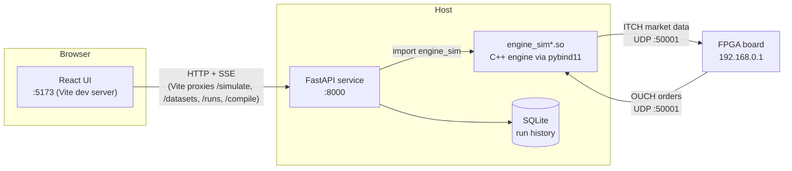

# System Testing

End-to-end testing of the whole stack: FPGA, engine, backend service, and
browser UI. This page is about testing the pieces **together**. For the engine
on its own see [engine-testing.md](engine-testing.md); for how the engine is
built internally see [engine-architecture.md](engine-architecture.md).

---

## The stack



Four layers, four places a failure can come from. Test them bottom-up — a
browser-level symptom is almost never a browser-level bug.

| Layer | Test it with | Doc |
|---|---|---|
| Engine | `make test`, `make test-python` | [engine-testing.md](engine-testing.md) |
| Backend | `curl` against `:8000` | below |
| Frontend | the browser, against a known-good backend | below |
| Hardware | `make run SCALE=1.0 ITCH_ADDR=192.168.0.1`, `tcpdump` | below + [`connection-test.md`](../../docs/connection-test.md) |

---

## 1. Software-only full stack

No board involved. This is the common case and the one to get working first.

### One command

```bash
cd sw && ./dev.sh
```

That creates `sw/service/.venv`, installs the API dependencies, builds
`engine_sim`, verifies the venv can import it, starts uvicorn, waits for it to
answer, then starts the UI dev server. Ctrl-C stops both.

Backend only — if you run the UI yourself, or don't have Node installed:

```bash
./dev.sh --no-ui
```

**Platform:** macOS, Linux, or WSL2. Native Windows is not supported (the
script needs `g++` and `make`, and the engine's online path only compiles off
`Windows_NT`). Windows users should work in WSL2.

### By hand

If something in `dev.sh` fails, the same steps individually:

```bash
# 1. Build the engine's Python module
cd sw/engine && make pymodule

# 2. Set up and start the API  (the venv path matters: the Makefile's
#    PY default and dev.sh both expect ../service/.venv)
cd ../service && python3 -m venv .venv
.venv/bin/pip install -r api/requirements.txt
cd api/src && ../../.venv/bin/uvicorn app:app --reload

# 3. Start the UI (second terminal)
cd sw/ui && npm install && npm run dev
```

### Verifying the backend without the browser

```bash
curl -sf http://127.0.0.1:8000/                 # health
curl -sf http://127.0.0.1:8000/datasets         # lists .bin files in data_pipeline/data
curl -sf -X POST http://127.0.0.1:8000/simulate \
     -H 'content-type: application/json' \
     -d '{"data_file": "synthetic_mbo_stream.bin", "trade_limit": 5, "pnl_limit": 5}'
curl -sf "http://127.0.0.1:8000/runs?limit=1"   # the run above must have been logged
```

If `/simulate` returns trades and a PnL curve, the engine, the bindings and the
service are all fine. Anything wrong after this point is the UI or the proxy.

### Verifying the UI

Open `http://localhost:5173`. The Vite dev server proxies `/simulate`,
`/datasets`, `/compile` and `/runs` to port 8000 (`sw/ui/vite.config.js`), so
no CORS setup is needed — both just have to be running.

Three routed pages:

| Page | What it exercises |
|---|---|
| **Online Simulation** (`/`) | the whole offline and loopback-online path |
| **Strategy Compiler** | `/compile/software` — compiles the user's `on_market_update` to a native binary and runs it |
| **Alpha Engine Compiler** | `/compile` — out-of-context Vivado synthesis. Needs Vivado on `PATH`; will fail without it |

On the Online Simulation page:

1. **Mode = Offline** → POSTs `/simulate`, blocks, renders when the run
   finishes. Expect a populated order blotter and PnL curve.
2. **Mode = Online, target loopback** → opens `/simulate/online/stream` (SSE)
   and updates live. The Top of Book card ticks every simulated second; the
   rest renders from the terminal `complete` event.

> Loopback online runs **do** produce trades — the service sets
> `enable_local_strategy = True` for them (`stream_manager.py`), because no
> board is attached to send orders. A *hardware*-target run deliberately leaves
> it off, so every trade you see there came from the real board.

---

## 2. Hardware in the loop

Everything above still applies; the board replaces the local strategy as the
source of orders.

**Before anything else**, work through the cold-start sequence in
[`docs/board-test-checklist.md`](../../docs/board-test-checklist.md): build and
program the bitstream, run `setup/net_setup.sh`, and confirm the physical link.
Do not skip the flood-ping step — if the board's activity LED doesn't blink,
the problem is cabling, PHY or host TX, and no amount of software debugging
will find it.

The one thing worth repeating here, because it causes silent failures:

> **The backend must run natively, not in a container or a NAT'd VM.** Either
> one puts the service on its own virtual network, where its UDP traffic never
> reaches the host's physical NIC and the board's replies never arrive. It
> looks like it "works" on loopback — the service talking to itself — and then
> receives nothing from real hardware. `dev.sh` runs natively for exactly this
> reason. On WSL2 you also need `networkingMode=mirrored` in `.wslconfig`.

### Engine ↔ board, without the UI

The narrowest hardware test. Two terminals:

```bash
# Terminal A — watch for frames the board sends
sudo tcpdump -i en5 -e -n ether src 00:0a:35:01:02:03

# Terminal B — stream market data at the board, in real time
cd sw/engine && make run SCALE=1.0 ITCH_ADDR=192.168.0.1
```

OUCH frames appearing in Terminal A is the only real proof the board received,
parsed and acted on the data. A final summary with a non-zero trade count means
the engine matched those orders.

### Full stack against the board

1. `sudo ./setup/net_setup.sh` (per session — macOS wipes it on every USB
   Ethernet re-enumeration).
2. `cd sw && ./dev.sh`.
3. In the UI: **Mode = Online**, target **Real Board**, run.

Trades appearing in the blotter means the whole chain worked: UI → service →
engine → ITCH over the wire → FPGA → OUCH back → matched → streamed to the
browser.

---

## 3. Narrowing a failure

Work inward from the symptom.

| Symptom | Most likely layer | Next step |
|---|---|---|
| `ImportError: Could not import the compiled 'engine_sim' module` | engine build | `make pymodule` in `sw/engine`; check `pybind11` is installed for the `python3` on `PATH` |
| `engine_sim` built but the venv can't import it | Python version mismatch | delete `sw/service/.venv` and re-run `dev.sh` — the module is built against whatever `python3` resolves to |
| `ModuleNotFoundError: fastapi` | API deps | use `.venv/bin/pip`, not the system `pip` |
| Dataset list empty in the UI | data files | confirm `.bin` files exist in `sw/data_pipeline/data`; `/datasets` lists exactly what's there |
| UI shows "Simulation failed: …" | backend or engine | read the API terminal — the real traceback is there |
| `Address already in use` on 8000 or 5173 | host | stop the other process, or move the port and update `API_TARGET` in `vite.config.js` |
| Offline run works, loopback online shows no trades | service config | check `enable_local_strategy` is being set for loopback targets |
| Hardware run completes with **zero trades** | board or link | board isn't sending OUCH. Go back to `tcpdump` + the activity LED; see [`connection-test.md`](../../docs/connection-test.md) |
| `tcpdump` shows nothing from the board, LED blinks | FPGA internals | bitstream loaded? Put an ILA on the RGMII RX or `rx_mac_core`'s outputs; persistent `rx_error` points at the RGMII RX clock-delay issue |
| `/compile` (Alpha Engine) fails | Vivado | not installed or not on `PATH` — expected outside a Vivado machine |

Two traps worth knowing:

- **You cannot `ping` the board to test connectivity.** It has no ARP, no ICMP
  and no TCP. 100% packet loss is the correct result; you're watching the
  activity LED, not the ping output.
- **`tcpdump` taps before the wire.** Seeing packets leave proves the kernel
  queued them, not that they reached the board. Only board-return traffic or
  the activity LED confirms delivery.

---

## 4. What CI covers

`.github/workflows/software-ci.yml`, on every PR touching `sw/`:

| Job | Covers |
|---|---|
| **Engine** (ubuntu + macOS) | builds the CLI and the Python module, runs all C++ unit tests, the Python binding tests, an offline simulation, and a loopback `online_run` |
| **API** | builds the module, starts the service, exercises `/`, `/datasets`, `/simulate` and `/runs` |
| **UI** | `npm ci && npm run build` |

CI does **not** cover the hardware path, the SSE streaming path, the Vivado
endpoint, or the browser itself. Those are manual, and this page is how you do
them.
